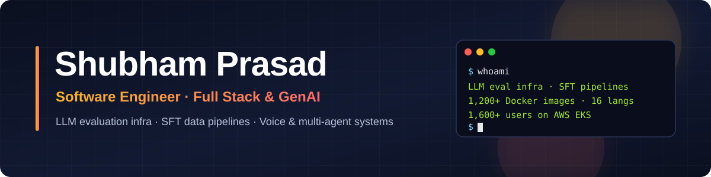

  

  

  
  
  
  
  

<i>Measure it, then ship it.</i>

---

## 👋 About me

AI Engineer at **Ethara AI** (Gurugram) building production GenAI systems: LLM evaluation and SFT-data infrastructure for a FAANG client, real-time voice agents, and multi-agent LLM applications. I like owning things end to end — from the Dockerfile to the eval dashboard — and I measure before I claim.

B.E. Computer Science, Nitte Meenakshi Institute of Technology, Bangalore (2021–2025, CGPA 8.85).

---

## 📈 Impact at a glance

| | |
|---|---|
| 🐳 **1,200+** multi-arch Docker images across **16 languages** | LLM evaluation infra aligned with Multi-SWE-bench (NeurIPS 2025) |
| 🧪 **50+** open-source projects (Redis, curl, systemd, Valkey) | Registry-driven eval harness scoring LLM patches deterministically |
| 🖼️ **500K+** image training dataset, solo-built pipeline | Multi-provider T2I/I2I orchestration with retries, QA and cost reporting |
| 👥 **1,600+** users on AWS EKS | Company-operations platform built and deployed single-handedly |
| ⚡ **~2s** voice-agent latency · **60%** lower ops cost | Dual-LLM realtime routing; LLM workflows moved to Lambda |
| 🧠 **700+** DSA problems · 🏆 **1st prize**, iNeuron (PW) Hackathon | C++ for DSA, Python for everything AI |

---

## 💼 Experience

**Ethara AI** — Software Engineer, Full Stack & GenAI · *Feb 2026 – Present*

- Built LLM evaluation infrastructure for a FAANG client: 1,200+ multi-arch Docker images (amd64/arm64) across 16 languages with BuildKit on AWS ECR for high-throughput parallel evaluation.
- Designed a registry-driven evaluation harness with per-repo build/dependency/test configs for 50+ open-source projects, scoring LLM-generated patches in isolated containers.
- Built the end-to-end Python pipeline that produced an SFT dataset for a FAANG model: mined bounty-linked GitHub issues, filtered issue-resolving PRs, extracted verified fix/test patches into JSONL ground truth.
- Solo-built a pipeline that generated a 500K+ image training dataset for a FAANG research team: SOTA model benchmarking, multi-provider APIs with concurrency and rate-limit handling, automated quality checks, live cost reporting.
- Built and deployed Ethara's company-operations platform (Flutter, Odoo, PostgreSQL, EKS) used by 1,600+ people.

**Meta Design Solution** — Software Engineer, Full Stack & GenAI · *May 2025 – Oct 2025*

- Production agentic voice agent for payment-reminder calls (FastAPI, LiveKit, OpenAI Realtime, Gemini Realtime, ElevenLabs, Twilio) with identity verification and risk-based escalation.
- Dual-LLM realtime inference with context-based routing at ~2s latency; migrated LLM workflows to AWS Lambda + API Gateway, cutting operational costs by 60%.

---

## 🚀 Featured projects

### 🩺 [AI HealthEngine](https://github.com/shubhamprasad318/AI_health_care) · [Live demo](https://ai-healthengine.onrender.com)
Health platform with a **voice doctor**. A calibrated LightGBM symptom-checker trained on the DDXPlus benchmark (1.16M patients, 49 conditions). Diagnosed poor accuracy on short inputs and retrained on partial-symptom copies, **raising 3-symptom top-3 accuracy from 57% → 97%**. A LiveKit + Gemini Live voice doctor reads each patient's history (consultations, labs, missed medicines) to follow up across visits, with a rule-based emergency system catching 91% of life-threatening cases from 3 symptoms.

`FastAPI` `LightGBM` `React` `MongoDB` `Gemini` `LiveKit`

### 🌍 [Multi-Agent Travel Orchestrator](https://github.com/shubhamprasad318/multi-agent-travel-orchestrator)
LangGraph pipeline where **6 specialized agents plan in parallel** with live SSE progress; a self-correcting validator scores each plan on 6 weighted criteria and sends low scorers back for revision, with budget arithmetic kept in code. Comes with its own **evaluation harness** (16 fixed trips, deterministic checks, LLM judge, revision-loop ablation) on an `/evals` dashboard, an 8-model quota-aware fallback chain, 100+ pytest tests, CI and Docker deploys.

`Python` `FastAPI` `LangGraph` `Gemini` `Next.js` `TypeScript` `MongoDB`

### 🎙️ [LiveKit Universal Agent](https://github.com/shubhamprasad318/LiveKit-Universal-Agent)
Voice AI agent that handles both browser sessions and phone calls (SIP), with RAG over a Pinecone knowledge base.

`Python` `LiveKit` `Pinecone`

More projects

 

- [**Multi-User Blogging Platform**](https://github.com/shubhamprasad318/Multi-User-Blogging-Platform) — Next.js 15, tRPC, Drizzle ORM, PostgreSQL; markdown editing and category management.
- [**Event Management**](https://github.com/shubhamprasad318/event_management) — Node.js event platform with auth, guest login and real-time updates over WebSockets.
- [**Brain Tumor Detection**](https://github.com/shubhamprasad318/brain-tumor-detection) — CNN-based binary and multi-class classification of brain MRI scans.

---

## 🛠️ Stack

  
   
  

**GenAI & LLMs:** LLM evaluation & benchmarking · SFT dataset curation · AI agents & multi-agent systems · LangGraph · LangChain · RAG · OpenAI / Gemini Realtime APIs · LiveKit · LightGBM · scikit-learn

---

## 📊 GitHub

  
  

---

## 🧩 Problem solving

  

  

---

## 📄 Resume

  
   
  

---

  📫 Open to <b>SDE and AI/ML engineering roles</b> · Gurugram, open to relocating to Bengaluru 
  <a href="mailto:shubhamprasad3758@gmail.com">shubhamprasad3758@gmail.com</a> · <a href="https://www.linkedin.com/in/shubham-prasad-320495196/">LinkedIn</a>

